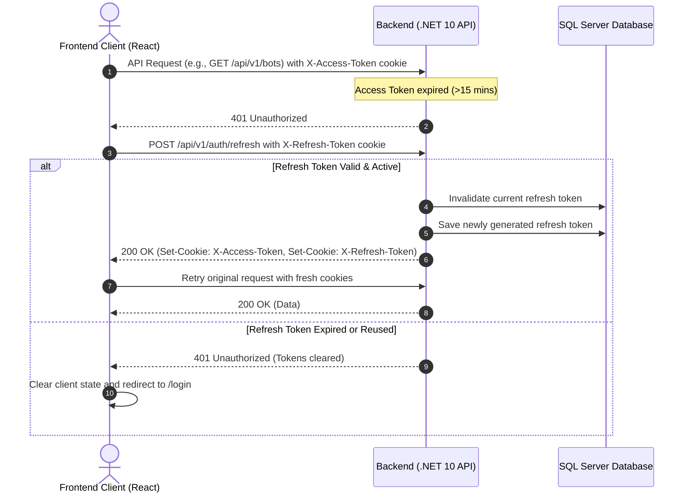

# FRONTEND_BACKEND_CONTRACT.md
## Production Integration Contract: Multi-Bot Automation & AI Agent SaaS Platform

> **Backend Architecture:** .NET 10 Web API, Clean Architecture, CQRS with MediatR, EF Core + SQL Server, ASP.NET Core Identity & JWT Authentication, Refresh Token Rotation with HTTP-Only Cookies, SignalR Hub, Node.js Playwright Workers.  
> **Frontend Target Stack:** React, TypeScript, Vite, Tailwind CSS, Axios, `@microsoft/signalr`.  
> **Contract Status:** Live & Fully Verified against current codebase.

---

## 1. API General Configuration

### 1.1 Base URL & Environment Configuration
- **Development Base URL:** `http://localhost:5000` (or `https://localhost:5001`)
- **Vite Local Dev Server Origin:** `http://localhost:5173`
- **Global Route Prefix:** `/api/v1/` for standard controllers
- **SignalR Hub Route:** `/hubs/notifications`

### 1.2 Content-Type & Payload Conventions
- All JSON requests must send: `Content-Type: application/json`.
- All endpoints accept and return UTF-8 encoded JSON with `camelCase` property naming conventions (`JsonNamingPolicy.CamelCase`).
- EF Core circular references are ignored using `ReferenceHandler.IgnoreCycles`.

### 1.3 Credentials & Cookie Requirements
- **Globally Mandatory:** All Axios requests and SignalR connections from the frontend **must** set `withCredentials: true`.
- Authentication uses **HTTP-Only cookies** (`X-Access-Token` and `X-Refresh-Token`).
- Raw JWT tokens are **never** accessible to frontend JavaScript via `document.cookie` or response bodies.
- The frontend must **not** set manual `Authorization: Bearer <token>` headers; the browser automatically attaches HTTP-only cookies on every request when `withCredentials: true` is configured.

### 1.4 CORS Configuration
The backend defines the `FrontendPolicy` in `Program.cs`:
- **Allowed Origins:**
  - `http://localhost:5173` (Vite dev server)
  - `http://localhost:3000` (Alternative local frontend)
  - Configured n8n cloud webhook origins
- **Allowed Headers:** Any (`AllowAnyHeader()`)
- **Allowed Methods:** Any (`AllowAnyMethod()`)
- **Credentials:** Allowed (`AllowCredentials()`)

### 1.5 Cookie Security Flags (Dev & Production)
Cookies are generated via `TokenService`:
- `HttpOnly`: `true` (always)
- `Secure`: `true` (enables cross-site cookie transmission)
- `SameSite`: `SameSiteMode.None` (enables cross-origin requests between Vite on `localhost:5173` and API on `localhost:5000`)
- `Path`: `/`

### 1.6 Standard & Custom Headers
| Header | Usage | Required By |
| :--- | :--- | :--- |
| `Accept: application/json` | Standard client request format | All requests |
| `Content-Type: application/json` | Standard POST/PUT request bodies | All POST/PUT requests |
| `x-worker-api-key` | Bot worker authentication header | Worker endpoints (`/api/v1/worker/*`) (*Note: The only endpoint that does not need x-worker-api-key is Worker dispatch endpoint*) |
| `X-Webhook-Secret` | n8n incoming webhook verification | Scrape completion endpoint (`/api/v1/scrapes/{id}/complete`) |

---

## 2. Authentication & Session Contract

### 2.1 Authentication Endpoints

#### 2.1.1 User Login
- **Method:** `POST`
- **Route:** `/api/v1/auth/login`
- **Auth Required:** No (Anonymous)
- **Request Body (`LoginRequestDto`):**
  ```json
  {
    "email": "user@example.com",
    "password": "Password123!"
  }
  ```
- **Response Body (`ApiResponse<AuthLoginResponseDto>`):**
  ```json
  {
    "isSuccess": true,
    "message": "Login successful.",
    "errorType": 0,
    "data": {
      "userId": "3fa85f64-5717-4562-b3fc-2c963f66afa6",
      "email": "user@example.com",
      "name": "Mazen Khtab",
      "role": "User"
    }
  }
  ```
- **Cookies Created in Response:**
  - `X-Access-Token`: Expiration 15 minutes, `HttpOnly: true`, `Secure: true`, `SameSite: None`, `Path: /`.
  - `X-Refresh-Token`: Expiration 7 days, `HttpOnly: true`, `Secure: true`, `SameSite: None`, `Path: /`.
- **Status Codes:**
  - `200 OK`: Successful authentication.
  - `400 Bad Request`: Validation failure (empty email or password).
  - `401 Unauthorized`: Invalid credentials or deleted/inactive account.

#### 2.1.2 Get Current User Identity / Session
- **Method:** `GET`
- **Route:** `/api/v1/auth/me`
- **Auth Required:** Yes (`[Authorize]`)
- **Request Body:** None
- **Response Body (`ApiResponse<AuthLoginResponseDto>`):**
  ```json
  {
    "isSuccess": true,
    "message": "User retrieved successfully.",
    "errorType": 0,
    "data": {
      "userId": "3fa85f64-5717-4562-b3fc-2c963f66afa6",
      "email": "user@example.com",
      "name": "Mazen Khtab",
      "role": "User"
    }
  }
  ```
- **Behavior:**
  - Reads authenticated user identity from claims (`ClaimTypes.NameIdentifier` and `ClaimTypes.Role`).
  - Verifies account existence in `Users` (or `SystmeAdmins`) table and checks `IsDeleted == false`.
  - Does **not** rotate tokens or set new cookies.
- **Status Codes:**
  - `200 OK`: Valid session.
  - `401 Unauthorized`: Unauthenticated or account deactivated/deleted.

#### 2.1.3 Refresh Token
- **Method:** `POST`
- **Route:** `/api/v1/auth/refresh`
- **Auth Required:** No explicit `[Authorize]` header required; reads cookie.
- **Request Body:** None (reads `X-Refresh-Token` cookie from HTTP request).
- **Response Body (`ApiResponse<AuthLoginResponseDto>`):**
  ```json
  {
    "isSuccess": true,
    "message": "Token refreshed successfully.",
    "errorType": 0,
    "data": {
      "userId": "3fa85f64-5717-4562-b3fc-2c963f66afa6",
      "email": "user@example.com",
      "name": "Mazen Khtab",
      "role": "User"
    }
  }
  ```
- **Cookies Rotated:**
  - Both `X-Access-Token` and `X-Refresh-Token` are renewed with fresh expirations.
  - Previous refresh token is revoked in database (`UserRefreshTokens`).
- **Status Codes:**
  - `200 OK`: Successful rotation.
  - `401 Unauthorized`: Missing or revoked/expired refresh token.

#### 2.1.4 User Logout
- **Method:** `POST`
- **Route:** `/api/v1/auth/logout`
- **Auth Required:** Yes (`[Authorize]`)
- **Request Body:** None
- **Response Body (`ApiResponse<bool>`):**
  ```json
  {
    "isSuccess": true,
    "message": "Logout successful.",
    "errorType": 0,
    "data": true
  }
  ```
- **Behavior:**
  - Reads `X-Refresh-Token` from request cookies.
  - Revokes matching token record in `UserRefreshTokens`.
  - Clears `X-Access-Token` and `X-Refresh-Token` cookies (sets expires to epoch in past).
- **Status Codes:**
  - `200 OK`: Successfully logged out.
  - `401 Unauthorized`: Unauthenticated.

#### 2.1.5 Admin Authentication Endpoints
Separated from standard client tables (`SystemAdmin` and `SystemAdminRefreshTokens`):
- `POST /api/v1/admin/auth/login`: Accepts `LoginRequestDto`, sets admin cookies, returns admin identity.
- `GET /api/v1/admin/auth/me`: `[Authorize]`. Returns currently authenticated admin identity (`AuthLoginResponseDto`) without rotating tokens or modifying cookies. Status `200 OK` on success, `401 Unauthorized` if unauthenticated or admin is inactive.
- `POST /api/v1/admin/auth/refresh`: Rotates admin refresh token from cookie.
- `POST /api/v1/admin/auth/logout`: Revokes admin refresh token and clears cookies.

#### 2.1.6 Registration & Password Reset
- **Registration:** **Not Found / Needs Clarification** (No registration endpoint currently exists in `AuthController`; accounts are seeded/created administratively).
- **Password Reset / Change:** **Not Found / Needs Clarification** (No password reset endpoints in `AuthController`).

---

### 2.2 Refresh Token Rotation & Session Invalidation Flow



#### Race Condition Handling (Concurrent 401s):
When multiple frontend API requests fail simultaneously with `401 Unauthorized`:
1. The frontend Axios response interceptor must maintain an `isRefreshing` lock flag and an array queue of pending requests.
2. The first failed request initiates `POST /api/v1/auth/refresh`.
3. Subsequent `401` requests are enqueued as callbacks waiting on the single refresh promise.
4. When refresh succeeds, all queued requests are replayed.
5. If refresh fails, the queue is rejected and the user is redirected to `/login`.

#### Single Active Session Policy:
- The backend enforces `SingleActiveSessionMiddleware` on regular user requests.
- Each login updates `User.CurrentSessionToken` in SQL Server and embeds that GUID into the `SessionToken` claim of the access token.
- If a user logs in from a second browser/device, calls from the first browser will return `401 Unauthorized` with:
  ```json
  { "message": "Your session has expired or ended because you logged in from another device." }
  ```

---

## 3. Authorization & Roles

### 3.1 Roles
- `User`: Standard platform customer. Scoped strictly to their own accounts, target groups, leads, and scrapes.
- `Admin`: System administrator.
- `SuperAdmin`: System super administrator with elevated privilege.

### 3.2 Authorization Rules
- All client dashboard endpoints require `[Authorize]` with role `User` (or admin).
- Admin endpoints reside under `/api/v1/admin/` and require administrative roles.
- Worker endpoints (`/api/v1/worker/*`) are protected by `[BotWorkerAuthorize]` requiring the `x-worker-api-key` header, except Worker dispatch endpoint which will be called from the front-end.
- Scrape completion webhook (`/api/v1/scrapes/{id}/complete`) is protected by `[N8nWebhookAuthorize]` requiring the `X-Webhook-Secret` header.

### 3.3 Account Status Checks
- When a user is marked `IsDeleted == true`, `GET /api/v1/auth/me` and login/refresh operations immediately reject with `401 Unauthorized`.

---

## 4. Standard API Response & Error Contract

### 4.1 Success Envelope Format
All successful operations return the `ApiResponse<T>` envelope:
```json
{
  "isSuccess": true,
  "message": "Operation completed successfully.",
  "errorType": 0,
  "data": { ... }
}
```

### 4.2 Error Envelope Format
When an operation fails, controllers return the `ApiErrorResponse` model:
```json
{
  "isSuccess": false,
  "statusCode": 400,
  "message": "One or more validation errors occurred.",
  "path": "/api/v1/scrapes",
  "method": "POST",
  "traceId": "0HN18S0GF2819:00000001",
  "details": null,
  "innerException": null
}
```
> *Note:* `details` and `innerException` contain stack trace info **only** when `ASPNETCORE_ENVIRONMENT == "Development"`.

### 4.3 ErrorType Enum Mapping
| Enum Name | Integer | HTTP Status | Meaning |
| :--- | :--- | :--- | :--- |
| `None` | `0` | 200 OK | Operation succeeded |
| `ValidationError` | `1` | 400 Bad Request | Invalid inputs or failed business validation |
| `NotFound` | `2` | 404 Not Found | Resource not found or not owned by user |
| `Unauthorized` | `3` | 401 Unauthorized | Missing, expired, or invalid session |
| `Forbidden` | `4` | 403 Forbidden | Access denied |
| `Conflict` | `5` | 409 Conflict | Concurrency or duplicate state conflict |
| `ServerError` | `6` | 500 Internal Error | Unhandled server or external network error |
| `TooManyRequests` | `7` | 429 Too Many Requests | Rate limit or duplicate job already in progress |

---

## 5. Pagination, Filtering, Sorting & Search

### 5.1 Request Conventions
- `pageNumber`: Integer (default `1`, 1-based indexing).
- `pageSize`: Integer (default `10`).
- `botId`: Integer filter (optional).
- `statusFilter`: String filter (optional).

### 5.2 Response Envelope Shape (`PaginatedResult<T>`)
List endpoints wrapping multiple items return `ApiResponse<PaginatedResult<T>>`:
```json
{
  "isSuccess": true,
  "message": "",
  "errorType": 0,
  "data": {
    "items": [ ... ],
    "totalItems": 42,
    "totalPages": 5,
    "currentPage": 1
  }
}
```

---

## 6. Client Dashboard APIs & Bot Registry

### 6.1 Bot Endpoints

#### 6.1.1 Get All Platform Bots
- **Method:** `GET`
- **Route:** `/api/v1/bots`
- **Auth:** `[Authorize]`
- **Query Params:** None
- **Response:** `ApiResponse<List<BotDto>>`
- **Behavior:** Returns all active bots available in the catalog, including whether the current user is subscribed (`isSubscribed: true/false`).

#### 6.1.2 Get User's Subscribed Bots
- **Method:** `GET`
- **Route:** `/api/v1/bots/subscribed`
- **Auth:** `[Authorize]`
- **Query Params:** None
- **Response:** `ApiResponse<List<BotDto>>`
- **Behavior:** Returns only the bots the authenticated user owns via the `UserBot` table.

#### 6.1.3 Get Bot by ID
- **Method:** `GET`
- **Route:** `/api/v1/bots/{id}`
- **Auth:** `[Authorize]`
- **Query Params:** `requireOwnership` (boolean, optional, default `false`).
- **Response:** `ApiResponse<BotDto>`

### 6.2 Complete `BotDto` Contract
```typescript
interface BotDto {
  id: number;
  name: string;
  description: string | null;
  currentPrice: number;
  uiModuleCode: string;
  cooldownMinutes: number;
  isActive: boolean;
  status: string;
  isSubscribed: boolean;
  subscribedAt: string | null; // ISO-8601 DateTime UTC
}
```

### 6.3 Stabilized `UiModuleCode` Values
The frontend Bot Registry dynamically mounts UI workspaces based on `uiModuleCode`. The supported codes defined in `SaaS.Domain.Constants.UiModuleCodes` are:

| Constant Key | Exact Value | Bot Purpose |
| :--- | :--- | :--- |
| `FbMembersScraper` | `FB-MEMBERS-SCRAPER` | Scrapes public/group Facebook member profiles |
| `FbPostsScraper` | `FB-POSTS-SCRAPER` | Scrapes posts and interactions from targeted Facebook groups |
| `FbMembersMessagesScraper` | `FB-MEMBERS-MESSAGES-SCRAPER` | Dispatches automated direct messages to collected leads |

---

## 7. Bot Workspace APIs

### 7.1 Connected Accounts Domain

#### 7.1.1 Get Eligible Connected Accounts for Scrape
- **Method:** `GET`
- **Routes:**
  - `/api/v1/connectedaccounts/eligible?botId={botId}`
  - `/api/v1/connectedaccounts/eligible/{botId}`
- **Auth:** `[Authorize]`
- **Rules Enforced:**
  - Account belongs to authenticated user (`UserId == currentUserId`).
  - Account is assigned to the requested bot (`BotId == botId`).
  - User owns subscription to bot (`UserBot` validated; returns 404 if not subscribed).
  - `IsActive == true`.
  - `Status == "Active"` (Accounts that are `"Busy"`, `"CoolingDown"`, `"AccountFlagged"`, or `"Banned"` are excluded).
  - Attached cookie exists and is not expired (`CookiesExpireDate > DateTime.UtcNow`).
- **Response Body (`ApiResponse<List<ConnectedAccountDto>>`):**
  ```json
  {
    "isSuccess": true,
    "message": "",
    "errorType": 0,
    "data": [
      {
        "id": 12,
        "displayName": "Facebook Sales Account #1",
        "platform": "Facebook",
        "expiredAt": "2026-10-25T14:30:00Z",
        "isActive": true
      }
    ]
  }
  ```
  *(If no account qualifies, returns `data: []` with status 200 OK, enabling the frontend to disable "Start Scrape").*

#### 7.1.2 List Connected Accounts
- **Method:** `GET`
- **Route:** `/api/v1/connectedaccounts`
- **Auth:** `[Authorize]`
- **Response:** `ApiResponse<List<ConnectedAccountDto>>`

#### 7.1.3 Get Connected Account Details
- **Method:** `GET`
- **Route:** `/api/v1/connectedaccounts/{id}`
- **Auth:** `[Authorize]`
- **Response Body (`ApiResponse<ConnectedAccountDetailsDto>`):**
  ```json
  {
    "isSuccess": true,
    "message": "",
    "errorType": 0,
    "data": {
      "id": 12,
      "displayName": "Facebook Sales Account #1",
      "platform": "Facebook",
      "maskedCookies": "sb=***; c_user=***",
      "expiredAt": "2026-10-25T14:30:00Z",
      "isActive": true,
      "relatedLeadsCount": 150,
      "scrapesCount": 14
    }
  }
  ```
  *(Note: Normalized property name is `expiredAt`, replacing previous `expAt`).*

#### 7.1.4 Create Connected Account
- **Method:** `POST`
- **Route:** `/api/v1/connectedaccounts`
- **Request Body (`AddConnectedAccountDto`):**
  ```json
  {
    "botId": 1,
    "displayName": "Facebook Account #2",
    "platform": "Facebook",
    "cookiesPayload": "[{\"name\":\"c_user\",\"value\":\"1000...\",\"domain\":\".facebook.com\"}]"
  }
  ```

#### 7.1.5 Update Connected Account
- **Method:** `PUT`
- **Route:** `/api/v1/connectedaccounts/{id}`
- **Request Body (`UpdateConnectedAccountDto`):**
  ```json
  {
    "displayName": "Facebook Account Renamed",
    "platform": "Facebook",
    "cookiesPayload": "[{\"name\":\"c_user\",\"value\":\"1000...\"}]",
    "status": "Active",
    "isActive": true,
  }
  ```

#### 7.1.6 Delete Connected Account
- **Method:** `DELETE`
- **Route:** `/api/v1/connectedaccounts/{id}`
- **Response:** `ApiResponse<bool>`

---

### 7.2 Target Groups Domain

#### 7.2.1 List Target Groups
- **Method:** `GET`
- **Route:** `/api/v1/targetgroups`
- **Auth:** `[Authorize]`
- **Response Body (`ApiResponse<List<GroupDto>>`):**
  ```json
  {
    "isSuccess": true,
    "message": "",
    "errorType": 0,
    "data": [
      {
        "id": 5,
        "groupName": "SaaS Entrepreneurs Group",
        "groupUrl": "https://www.facebook.com/groups/saasentrepreneurs",
        "isActive": true
      }
    ]
  }
  ```

#### 7.2.2 Get Target Group Details
- **Method:** `GET`
- **Route:** `/api/v1/targetgroups/{id}`
- **Auth:** `[Authorize]`
- **Response Body (`ApiResponse<GroupDetailsDto>`):**
  ```json
  {
    "isSuccess": true,
    "message": "",
    "errorType": 0,
    "data": {
      "id": 5,
      "groupName": "SaaS Entrepreneurs Group",
      "groupUrl": "https://www.facebook.com/groups/saasentrepreneurs",
      "configJson": "{\"keywords\": [\"founder\", \"ceo\"]}",
      "isActive": true,
      "relatedLeadsCount": 45,
      "scrapesCount": 3
    }
  }
  ```
  *(Note: Normalized property name is `groupUrl`, replacing previous `groupURL`).*

#### 7.2.3 Create Target Group
- **Method:** `POST`
- **Route:** `/api/v1/targetgroups`
- **Request Body (`AddGroupDto`):**
  ```json
  {
    "botId": 1,
    "groupName": "Tech Startups Hub",
    "groupUrl": "https://www.facebook.com/groups/techstartups",
    "configJson": "{\"minMembers\": 1000}",
    "isActive": true
  }
  ```

#### 7.2.4 Update Target Group
- **Method:** `PUT`
- **Route:** `/api/v1/targetgroups/{id}`
- **Request Body (`UpdateGroupDto`):**
  ```json
  {
    "groupName": "Updated Group Name",
    "groupUrl": "https://www.facebook.com/groups/techstartups",
    "configJson": "{\"minMembers\": 2000}",
    "isActive": true
  }
  ```

#### 7.2.5 Delete Target Group
- **Method:** `DELETE`
- **Route:** `/api/v1/targetgroups/{id}`
- **Response:** `ApiResponse<bool>`

---

### 7.3 Leads Domain

#### 7.3.1 Get Leads for Bot
- **Method:** `GET`
- **Route:** `/api/leads/leads/{botId}`
- **Auth:** `[Authorize]`
- **Query Params:**
  - `pageNumber` (default `1`)
  - `pageSize` (default `10`)
  - `statusFilter` (optional, e.g., `"Pending"`, `"Contacted"`, `"Qualified"`)
- **Response:** `ApiResponse<PaginatedResult<LeadDto>>`

#### 7.3.2 Get Messaging Preview Leads
- **Method:** `GET`
- **Route:** `/api/leads/bot/messaging-preview/{botId}`
- **Auth:** `[Authorize]`
- **Response:** `ApiResponse<List<LeadDto>>`

---

### 7.4 Worker Dispatch & Updates

#### 7.4.1 Dispatch Messaging Job (User Initiated)
- **Method:** `POST`
- **Route:** `/api/v1/worker/dispatch-messaging`
- **Auth:** `[Authorize]`
- **Request Body (`DispatchMessagingDto`):**
  ```json
  {
    "botId": 3,
    "accountId": 12,
    "leadIds": [101, 102, 103]
  }
  ```
- **Response Body (`ApiResponse<DispatchMessagingResultDto>`):**
  ```json
  {
    "isSuccess": true,
    "message": "Job accepted successfully.",
    "errorType": 0,
    "data": {
      "jobId": 85,
      "status": "Pending",
      "totalLeadsCount": 3
    }
  }
  ```

#### 7.4.2 Worker Node Callbacks (Protected by `x-worker-api-key`)
- `PUT /api/v1/worker/leads/{leadId}/status` - Update lead status (`UpdateStatusDto: { status: string }`).
- `PUT /api/v1/worker/jobs/{jobId}/status` - Update job status (`UpdateStatusDto: { status: string }`).
- `PUT /api/v1/worker/accounts/{accountId}/status` - Update account status (`UpdateStatusDto: { status: string }`).
- `POST /api/v1/worker/activity-log` - Post bot audit log (`LogBotActivityCommand`).

---

## 8. Scrapes / Jobs Contract

### 8.1 Scrapes Endpoints

#### 8.1.1 Start / Create Scrape
- **Method:** `POST`
- **Route:** `/api/v1/scrapes`
- **Auth:** `[Authorize]`
- **Request Body (`CreateScrapeDto`):**
  ```json
  {
    "botId": 1,
    "connectedAccountId": 12,
    "targetGroupId": 5,
    "infoJson": "{\"keywords\": [\"software\", \"founder\"], \"scrapeLimit\": 100}"
  }
  ```
- **Response Body (`ApiResponse<int>`):**
  ```json
  {
    "isSuccess": true,
    "message": "Scrape started successfully.",
    "errorType": 0,
    "data": 42
  }
  ```
- **Behavior:**
  - Validates user subscription to `BotId`.
  - Verifies account eligibility (`Status == "Active" && IsActive == true`).
  - Sets connected account `Status = "Busy"`.
  - Creates a `Scrape` record with `Status = "Running"`.
  - Triggers the configured n8n webhook for the bot's `UiModuleCode`.

#### 8.1.2 List Scrapes
- **Method:** `GET`
- **Route:** `/api/v1/scrapes`
- **Auth:** `[Authorize]`
- **Query Params:**
  - `botId`: Integer (optional)
  - `pageNumber`: Integer (default `1`)
  - `pageSize`: Integer (default `10`)
  - `statusFilter`: String (optional, e.g. `"Running"`, `"Completed"`, `"Cancelled"`, `"Failed"`)
- **Response Body (`ApiResponse<PaginatedResult<ScrapeDto>>`):**
  ```json
  {
    "isSuccess": true,
    "message": "",
    "errorType": 0,
    "data": {
      "items": [
        {
          "id": 42,
          "botId": 1,
          "groupId": 5,
          "accountId": 12,
          "collectedLeadsCount": 35,
          "infoJson": "{\"keywords\":[\"software\"]}",
          "startedAt": "2026-10-12T14:00:00Z",
          "endedAt": null,
          "status": "Running"
        }
      ],
      "totalItems": 1,
      "totalPages": 1,
      "currentPage": 1
    }
  }
  ```

#### 8.1.3 Get Scrape by ID
- **Method:** `GET`
- **Route:** `/api/v1/scrapes/{id}`
- **Auth:** `[Authorize]`
- **Response Body (`ApiResponse<ScrapeDto>`):**
  ```json
  {
    "isSuccess": true,
    "message": "",
    "errorType": 0,
    "data": {
      "id": 42,
      "botId": 1,
      "groupId": 5,
      "accountId": 12,
      "collectedLeadsCount": 35,
      "infoJson": "{\"keywords\":[\"software\"]}",
      "startedAt": "2026-10-12T14:00:00Z",
      "endedAt": null,
      "status": "Running"
    }
  }
  ```

#### 8.1.4 Cancel Scrape
- **Method:** `POST`
- **Route:** `/api/v1/scrapes/{id}/cancel`
- **Auth:** `[Authorize]`
- **Response Body (`ApiResponse<bool>`):**
  ```json
  {
    "isSuccess": true,
    "message": "Scrape cancelled successfully.",
    "errorType": 0,
    "data": true
  }
  ```
- **State Transitions & Business Rules:**
  - Validates that the scrape belongs to the authenticated user.
  - Can only cancel scrapes whose status is currently `"Running"`. If already `"Completed"`, `"Failed"`, or `"Cancelled"`, returns `400 Bad Request` (`ValidationError`).
  - Updates `Scrape.Status = "Cancelled"` and records `Scrape.EndedAt = DateTime.UtcNow`.
  - If the attached `ConnectedAccount` is `"Busy"`, reverts its status to `"Active"` so it is immediately unlocked for future scrapes.

#### 8.1.5 Complete Scrape (n8n Webhook Callback)
- **Method:** `POST`
- **Route:** `/api/v1/scrapes/{id}/complete`
- **Auth:** Header `X-Webhook-Secret`
- **Request Body (`CompleteScrapeDto`):**
  ```json
  {
    "extractedLeads": [
      {
        "externalId": "fb_102030",
        "username": "john.doe",
        "fullName": "John Doe",
        "aiMessage": "Hello John...",
        "metadataJson": "{\"profileLink\": \"...\"}"
      }
    ]
  }
  ```
- **Behavior:** Saves leads, increments `CollectedLeadsCount`, marks scrape as `"Completed"`, reverts account to `"Active"`, and sends SignalR `ScrapeCompleted` event to client.

#### 8.1.6 Retry Scrape
- Retry Scrape = Not supported.
- If user wants to execute again: Create a new Scrape.

### 8.2 Enums and Domain Status Values

#### Scrape Status (`ScrapeStatus`)
- `"Pending"`
- `"Running"`
- `"Completed"`
- `"Failed"`
- `"Cancelled"`

#### Job Status (`JobStatus`)
- `"Pending"`
- `"Processing"`
- `"Completed"`
- `"Failed"`

#### Account Status (`AccountStatus`)
- `"Active"`: Eligible to be picked for scrapes.
- `"Busy"`: Currently executing a scrape or worker task.
- `"CoolingDown"`: In post-scrape cooldown period.
- `"AccountFlagged"`: Flagged by external platform.
- `"Banned"`: Account banned.

---

### 8.3 Scrape Naming and Integration Requirements

- The backend uses `Scrape`, `ScrapeDto`, `CreateScrapeDto`, `CompleteScrapeDto`, and `ScrapeStatus` throughout the domain, CQRS handlers, API, and tests.
- Client routes are `GET /api/v1/scrapes`, `GET /api/v1/scrapes/{id}`, `POST /api/v1/scrapes`, and `POST /api/v1/scrapes/{id}/cancel`.
- n8n completion callbacks use `POST /api/v1/scrapes/{id}/complete` with the existing `X-Webhook-Secret` header and `CompleteScrapeDto` body.
- n8n dispatch JSON now contains `scrapeId`, `cookies`, `info`, `companyName`, and `companyPitch`. Update external workflow consumers to read `scrapeId`.
- The SignalR completion event is `ScrapeCompleted`; its payload contains `scrapeId` and `leadsCount`.
- Connected-account and target-group detail DTOs expose `scrapesCount`.
- The SQL table is `Scrapes` (plural), the DbSet and owner collection navigations are `Scrapes`, the primary key remains `Id` with constraint `PK_Scrapes`, and leads reference it through `ScrapeId` / `Scrape` with constraint `FK_Leads_Scrapes_ScrapeId`. Related foreign keys and indexes use Scrape names.
- Status values remain `Pending`, `Running`, `Completed`, `Failed`, and `Cancelled`.
- The previously deleted migration history remains deleted. `initialMigration` creates the current schema for a fresh database; it is not an in-place migration for an existing database. The migration has not been applied to a live SQL Server database.

---
## 9. Real-Time SignalR Notification Contract

### 9.1 Hub Connection Setup
- **Hub URL:** `/hubs/notifications`
- **Transport:** WebSockets (fallback to Long Polling).
- **Client Configuration:**
  ```typescript
  import * as signalR from "@microsoft/signalr";

  const connection = new signalR.HubConnectionBuilder()
    .withUrl("http://localhost:5000/hubs/notifications", {
      withCredentials: true // Transmits authentication cookies
    })
    .withAutomaticReconnect()
    .build();
  ```

### 9.2 Real-Time Events Emitted by Server

#### `ScrapeCompleted`
- **Trigger:** Fired when a scraping scrape finishes via n8n callback.
- **Payload:**
  ```typescript
  interface ScrapeCompletedPayload {
    scrapeId: number;
    leadsCount: number;
  }
  ```

#### `LeadStatusUpdated`
- **Trigger:** Fired when a lead status is modified by worker processing.
- **Payload:**
  ```typescript
  interface LeadStatusUpdatedPayload {
    leadId: number;
    status: string; // e.g. "Contacted", "Failed"
  }
  ```

#### `JobFailed`
- **Trigger:** Fired when a background worker job encounters an unrecoverable failure.
- **Payload:**
  ```typescript
  interface JobFailedPayload {
    jobId: number;
    message: string;
  }
  ```

---

## 10. User Settings API

Verified against the settings controller, existing CQRS handlers, FluentValidation pipeline, cookie JWT authentication, and relational integration tests on 2026-10-13.

### 10.1 Authorization and Ownership
- Both endpoints require an authenticated regular user: `[Authorize(Roles = "User")]`.
- Send the `X-Access-Token` HTTP-only cookie using `withCredentials: true`, as with other client APIs. Existing single-active-session checks apply.
- The backend derives `UserId` exclusively from `ClaimTypes.NameIdentifier`. Neither endpoint supports selecting another user's settings.
- `UserId` is absent from the update DTO. Supplying `userId` or any other unsupported JSON property returns `400 Bad Request`.
- Anonymous/invalid-cookie requests return `401 Unauthorized`; authenticated callers without role `User` (including Admin and SuperAdmin) return `403 Forbidden`.
- Authentication/authorization failures retain the existing middleware behavior: JWT challenge/forbid responses may have no JSON body; session failures use the message-only responses documented in section 2.2.

### 10.2 Get Current User Settings
- **Method:** `GET`
- **Route:** `/api/v1/settings`
- **Request body / supported query parameters:** None.
- **Response:** `ApiResponse<UserSettingsDto>`.

```json
{
  "isSuccess": true,
  "message": "Settings retrieved successfully.",
  "errorType": 0,
  "data": {
    "hasAIApiKey": true,
    "maskedAIApiKey": "***************1234",
    "hasScraperToken": true,
    "maskedScraperToken": "********************5678",
    "dailyLeadLimit": 30,
    "companyName": "Example company",
    "companyPitch": "We automate sales outreach."
  }
}
```

```typescript
interface UserSettingsDto {
  hasAIApiKey: boolean;
  maskedAIApiKey: string;
  hasScraperToken: boolean;
  maskedScraperToken: string;
  dailyLeadLimit: number; // Maps to UserSetting.DailyMessageLimit.
  companyName: string | null;
  companyPitch: string | null;
}
```

- `companyName` and `companyPitch` return the authenticated user's saved company information.
- Only credential-presence flags and masked values are returned; raw secrets and ciphertext are never returned.
- Existing masking exposes at most the last four characters, masks shorter credentials entirely, and caps the masked string length at 50. Missing credentials have a false flag and an empty masked string. A decryption failure yields an empty mask while retaining the presence flag.
- If no settings record exists, GET returns `200 OK`, message `No settings found for the user.`, and `data: { hasAIApiKey: false, maskedAIApiKey: "", hasScraperToken: false, maskedScraperToken: "", dailyLeadLimit: 0, companyName: null, companyPitch: null }`. GET does not create a record.

### 10.3 Update Current User Settings
- **Method:** `PUT`
- **Route:** `/api/v1/settings`
- **Request DTO:** `UpdateUserSettingsDto`.

```json
{
  "aiApiKey": "replacement-ai-api-key",
  "scraperToken": "replacement-scraper-token",
  "dailyLeadLimit": 30,
  "companyName": "Example company",
  "companyPitch": "We automate sales outreach."
}
```

```typescript
interface UpdateUserSettingsDto {
  aiApiKey?: string | null;
  scraperToken?: string | null;
  dailyLeadLimit: number; // Required nonnegative Int32 (0 through 2147483647).
  companyName?: string | null; // Maximum 100 characters.
  companyPitch?: string | null;
}
```

- `dailyLeadLimit` must be supplied. Zero is valid and is persisted as zero, including when the settings record is first created. Negative, null, malformed, fractional, or out-of-range values fail validation/binding.
- Nonblank `aiApiKey` / `scraperToken` values replace the corresponding credential after encryption. Omitted, null, empty, or whitespace-only credentials preserve existing values; they do not clear stored credentials.
- Supplied non-null `companyName` / `companyPitch` values replace the corresponding company field. Omitted or null company fields preserve existing values. An empty string clears a company field to an empty string. Company values are stored as supplied, without trimming.
- `companyName` accepts at most 100 characters, matching the existing database column. `companyPitch` uses the existing nullable `nvarchar(max)` column with no additional application length limit. Company fields are optional and are not required to be nonempty.
- If no record exists, PUT creates one for the authenticated user with the supplied limit, optional company information, and optional encrypted credentials. Omitted/null company fields on creation are stored as null.
- `id`, `userId`, encrypted fields, and other unsupported JSON properties are rejected.
- **Success response:** `200 OK`, `ApiResponse<Guid>`; `data` is the authenticated user's ID (the existing command result), not a settings DTO. Refetch GET after saving to obtain the current company information and credential masks.

```json
{
  "isSuccess": true,
  "message": "Settings updated successfully.",
  "errorType": 0,
  "data": "3fa85f64-5717-4562-b3fc-2c963f66afa6"
}
```

### 10.4 Validation Errors
- Invalid settings JSON and FluentValidation failures return `400 Bad Request` using `ApiErrorResponse`, including `isSuccess`, `statusCode`, `message`, `path`, `method`, and `traceId`.
- Binding failures (including company values supplied as objects or numbers) use message `Invalid settings request. Supply dailyLeadLimit as an integer and only supported settings fields.`
- A negative limit uses the existing validator message `DailyLeadLimit must be greater than or equal to 0.`
- A company name over 100 characters uses message `CompanyName must be 100 characters or fewer.`
- Invalid requests do not create or update settings, including the company fields.

### 10.5 Existing Behavior and Unresolved Product Decisions
- The existing no-record GET limit is `0`; the entity initializer is `30`, and the SQL column default is `50`. This API preserves those defaults and requires an explicit limit on PUT. A single product-wide default remains undecided.
- Credential deletion has no existing command semantics. Company information can be edited through these endpoints; no new database migration is needed because both company columns already exist.
- The settings creation handler and read mapper previously swapped AI and scraper credential columns, while updates used the correct columns. Creation and reads now use `AIApiKeyEncrypted` for AI keys and `ScraperApiTokenEncrypted` for scraper tokens. Historical records may contain swapped or mixed credentials; no automatic data swap is safe without inspecting their provenance. Affected users should re-enter both credentials.
- Integration tests use cookie JWT authentication, the production middleware/handlers/EF model, and SQLite with SQL Server type/default syntax adapted. A live SQL Server deployment was not exercised.

---

## 11. Bot Activity Logs Read API

Verified against the controller, CQRS validation/handler, cookie JWT/session authorization, relational integration tests, and generated SQL Server migration on 2026-10-14.

### 11.1 List Activity Logs
- **Method:** `GET`
- **Route:** `/api/v1/activity-logs`
- **Auth:** `[Authorize(Roles = "User")]`. Send the `X-Access-Token` HTTP-only cookie with `withCredentials: true`. Existing single-active-session checks apply.
- **Response:** `ApiResponse<PaginatedResult<BotActivityLogDto>>`.
- **Supported query parameters:**

| Parameter | Type | Default / validation | Meaning |
| :--- | :--- | :--- | :--- |
| `botId` | Integer, optional | Greater than zero | Logs explicitly associated with a bot the caller owns through `UserBot`. |
| `runId` | String, optional | Nonblank; maximum 100 characters | Equality filter on the existing opaque `BotActivityLog.CorrelationId`. This is a correlation identifier, not a numeric `Job.Id` or `Scrape.Id`. |
| `logLevel` | String, optional | `INFO`, `WARN`, or `ERROR` | Matches the stored log level. Use uppercase values. |
| `pageNumber` | Integer | `1`; at least 1 | Requested page. |
| `pageSize` | Integer | `10`; 1 through 100 | Maximum items per page. |

- All supplied filters are combined before counting and pagination. Correlation equality follows the database collation; no substring matching or ID inference is used.
- Results are ordered by `createdAt` descending, then `id` descending to make tied timestamps deterministic.
- The pagination offset `(pageNumber - 1) * pageSize` must fit in an Int32; larger offsets return `400`.
- An empty list returns `200`, `items: []`, `totalItems: 0`, `totalPages: 0`, and the requested `currentPage`. Pages beyond the last page also return `200` with no items and the actual total counts.

```json
{
  "isSuccess": true,
  "message": "Activity logs retrieved successfully.",
  "errorType": 0,
  "data": {
    "items": [
      {
        "id": 85,
        "correlationId": "messaging-correlation-42",
        "logLevel": "ERROR",
        "message": "Messaging task failed.",
        "createdAt": "2026-10-14T12:00:00"
      }
    ],
    "totalItems": 1,
    "totalPages": 1,
    "currentPage": 1
  }
}
```

```typescript
interface BotActivityLogDto {
  id: number; // Backend Int64, serialized using the existing JSON number convention.
  correlationId: string;
  logLevel: string;
  message: string;
  createdAt: string; // UTC database timestamp; SQL datetime does not preserve a timezone suffix.
}
```

### 11.2 Ownership and Errors
- The controller derives `UserId` exclusively from `ClaimTypes.NameIdentifier`. A supplied `userId` query parameter is ignored and cannot select another user's logs.
- Every query restricts logs to the authenticated user's `BotActivityLog.UserId`; null-owner/system logs and other users' logs are excluded, including when correlation IDs or bots are shared.
- For logs with a `BotId`, the caller must also have a matching `UserBot` subscription. This check applies to unfiltered reads and correlation-only reads as well as bot-filtered reads. Logs with mismatched or revoked bot ownership are excluded.
- A supplied unowned or nonexistent `botId` returns `404` with message `User or bot not found.`
- A supplied `runId` must have at least one visible log for the caller; an unknown, system-only, or other-user-only correlation returns `404` with message `Activity log run not found.` No separate run registry exists. An existing visible correlation with no matches for additional bot/level filters returns an empty `200` page.
- Not-found responses use the standard `ApiErrorResponse` with `statusCode`, `message`, `path`, `method`, and `traceId`.
- FluentValidation failures return `400` using `ApiErrorResponse`. Numeric model-binding failures retain the existing ASP.NET Core validation response. Unsupported query parameters have no effect.
- Anonymous/invalid-cookie requests and invalidated sessions return `401`; authenticated non-User roles return `403`. Authentication failures retain the existing middleware response behavior described in sections 2.2 and 10.1.
- The response DTO never includes `stackTrace`, raw exception details, or `userId`, in production or development. Stored stack traces remain available internally; the existing `message` field is returned as stored.

### 11.3 Bot Association and Worker Compatibility
- The previous model stored only an owner and an opaque correlation, with no bot/job/scrape relation. Bot filtering requires the new nullable `BotActivityLog.BotId` association; no job or scrape mapping is guessed from correlation text.
- `POST /api/v1/worker/activity-log` retains its existing `x-worker-api-key` protection and request/result behavior. Its existing command now optionally accepts `botId` (positive integer). When present, the backend verifies that the supplied worker-side `userId` owns that bot through `UserBot`; mismatched associations return `404` without writing a log.
- Existing worker submissions that omit `botId` continue to work unchanged. To make new logs appear in bot-filtered lists, worker integrations must submit the optional `botId`.
- Historical/unassociated logs retain `BotId = null`, remain readable by their owner in unfiltered or correlation/level-filtered lists, and are excluded from bot-filtered results. There is no automatic backfill because the old correlation does not establish a bot relationship.
- The current consolidated migration `20261013212118_initialMigration` creates the nullable `BotId`, its FK to `Bots` with `ON DELETE SET NULL`, and bot/owner pagination indexes as part of the fresh-database schema. It replaces the previous initial and activity-log association migrations in the repository. It is not an in-place upgrade migration for an existing database. Its SQL/model consistency is verified; no live SQL Server database was modified.
- Integration coverage includes pagination and tied timestamps, bot/correlation/level/combined filtering, shared-resource isolation, revoked ownership, userId spoofing, anonymous and invalid-token/session access, role restrictions, validation, production stack-trace exclusion, old/new worker submissions, and migration SQL generation. Relational API tests use SQLite with the production EF model's SQL Server types/defaults adapted.


---

## 12. Admin Users Management

Implemented using the existing `SystemAdmin` roles, cookie JWT authentication, CQRS/MediatR validation pipeline, and `IAppDbContext` persistence. Verified with relational HTTP integration tests on 2026-10-14. No schema migration is required.

### 12.1 Authorization and Response DTO

- Every endpoint requires `[Authorize(Roles = "Admin,SuperAdmin")]`. Use the cookies issued by `/api/v1/admin/auth/login` with `withCredentials: true`.
- The backend derives the administrative identity from `ClaimTypes.NameIdentifier` and uses the existing `GetCurrentAdminQuery` to verify an active `SystemAdmin` record. Its current stored role must be `Admin` or `SuperAdmin` and match a role in the JWT. A changed role requires a fresh admin login.
- Anonymous/invalid-token requests return `401`. Valid tokens with other roles (`User`, `Support`, `Worker`, or the literal role `SystemAdmin`) return `403`; `SystemAdmin` is the existing entity name, while administrative role values are `Admin` and `SuperAdmin`.
- Missing/inactive admin records and invalid admin identities return `401`; a stale token with a changed administrative role returns `403`. A supplied user/admin ID cannot override the caller's authenticated identity.
- These APIs manage regular `User` records, including deactivated records. They do not create administrative accounts or assign roles, bots, or subscriptions.
- Every successful item/detail/write response uses the following allowlisted DTO. Password hashes, plaintext passwords, refresh/session tokens, login IPs, encrypted credentials, settings, and navigation collections are excluded.

```typescript
interface AdminUserDto {
  id: string; // GUID.
  fullName: string;
  email: string;
  phoneNumber: string;
  isDeleted: boolean; // true = deactivated, false = active.
  createdAt: string; // UTC database timestamp; SQL datetime may omit the timezone suffix.
}
```

### 12.2 List and Detail

| Method | Route | Response |
| :--- | :--- | :--- |
| `GET` | `/api/v1/admin/users` | `200`, `ApiResponse<PaginatedResult<AdminUserDto>>`; message `Users retrieved successfully.` |
| `GET` | `/api/v1/admin/users/{id}` | `200`, `ApiResponse<AdminUserDto>`; message `User retrieved successfully.` |

List query parameters:

| Parameter | Type | Default / behavior |
| :--- | :--- | :--- |
| `pageNumber` | Integer | Default `1`; at least 1. |
| `pageSize` | Integer | Default `10`; 1 through 100. |
| `search` | Optional string | At most 255 characters; trimmed, case-insensitive substring search across full name and email. Blank search applies no filter. |
| `isDeleted` | Optional boolean | `false` selects active users; `true` selects deactivated users; omitted includes both. |

- Filters are applied together before counting/pagination. Results are ordered by `createdAt` descending, then `id` ascending for deterministic ordering of equal timestamps.
- The standard pagination fields are `items`, `totalItems`, `totalPages`, and `currentPage`. Empty results return `200` with zero totals; pages beyond the end return empty items with actual totals and the requested page number.
- Pagination offsets greater than Int32 maximum return `400`.
- Detail includes deactivated users so administrators can inspect and reactivate them. Missing IDs return `404` with message `User not found.` GUID-empty IDs fail validation with `400`; malformed GUID route segments do not match the endpoint and return `404`.

### 12.3 Create User

- **Method/route:** `POST /api/v1/admin/users`.
- **Request:** `CreateAdminUserDto`.

```json
{
  "fullName": "Example User",
  "email": "user@example.com",
  "password": "initial-password",
  "phoneNumber": "01012345678"
}
```

- `fullName` is required/nonblank, maximum 100 characters. `email` is required, must pass the project's FluentValidation email rule, and has maximum length 255. `password` is required/nonblank and uses the existing password-hashing policy.
- `phoneNumber` is optional and defaults to an empty string. Explicit null is invalid. No additional phone-format policy is introduced.
- Full name, email, and phone are trimmed before persistence. Passwords are hashed as supplied through `IPasswordHasherService` / the existing enhanced BCrypt implementation and configured work factor.
- The backend generates the ID and timestamp and creates an active regular user (`isDeleted: false`). It does not establish a login session, set auth cookies, create settings, or change the administrator's login. The new user can log in through the existing user login endpoint.
- **Success:** `201 Created`, `ApiResponse<AdminUserDto>`, message `User created successfully.`, and `Location` pointing to the detail endpoint.
- Email uniqueness is checked case-insensitively against all regular users, including deactivated accounts. Duplicate emails return `409` with message `Email is already in use.` The existing SQL Server email unique index also protects database uniqueness; SQL Server unique-constraint errors return the same conflict response.
- `id`, `isDeleted`, `role`, password hashes, session fields, settings, and other unsupported JSON properties return `400`. This is admin-managed creation; no public registration endpoint is added.

### 12.4 Update User Profile

- **Method/route:** `PUT /api/v1/admin/users/{id}`.
- **Request:** `UpdateAdminUserDto`.

```json
{
  "fullName": "Updated User",
  "email": "updated@example.com",
  "phoneNumber": "01087654321"
}
```

- Full name/email validation, trimming, and duplicate-email handling match creation. `fullName` and `email` must be supplied. Phone defaults to empty when omitted; null is invalid.
- This is a profile replacement, not a partial patch. Deactivated users can also be updated. The existing password hash, creation timestamp, deletion status, settings, resources, and sessions are preserved.
- Updating to the current user's own email is allowed. Another user's email, including a deactivated user's email, returns `409` without changing the profile.
- **Success:** `200`, `ApiResponse<AdminUserDto>`, message `User updated successfully.` Missing users return `404`.
- Password/passwordHash, role, deletion status, IDs, and internal/security fields are not supported in this DTO and return `400`. Status changes use the dedicated endpoints below.

### 12.5 Deactivate / Reactivate

| Method | Route | Behavior / success message |
| :--- | :--- | :--- |
| `POST` | `/api/v1/admin/users/{id}/deactivate` | Sets `IsDeleted = true`; `User deactivated successfully.` |
| `POST` | `/api/v1/admin/users/{id}/reactivate` | Sets `IsDeleted = false`; `User reactivated successfully.` |

- No request body is required. Both return `200`, `ApiResponse<AdminUserDto>`. Missing users return `404`.
- Deactivation is a soft delete. It preserves the user row and related data, clears `CurrentSessionToken`, and marks active refresh tokens inactive with their expiration set to the revocation time. These changes are committed together by a single `SaveChangesAsync`.
- Existing login and refresh-token handlers already reject `IsDeleted` users. `SessionTokenValidator` now also filters out deleted users, so existing access cookies are rejected on subsequent authenticated requests even if a legacy record still retains a session token.
- Reactivation permits fresh login; it never restores a revoked session or refresh token. Reactivating a deleted user clears any leftover session and revokes lingering active refresh tokens. Repeating deactivation is safe; reactivating an already-active user leaves their valid current session intact.

### 12.6 Error Format and Verification

- Controller/command errors and FluentValidation failures use the existing `ApiErrorResponse` with `isSuccess`, `statusCode`, `message`, `path`, `method`, and `traceId`. Validation/binding errors return `400`; missing users return `404`; duplicate emails return `409`.
- Binding failures (including unknown JSON fields) use message `Invalid user management request. Supply valid values and only supported fields.` Authentication challenge/forbid responses retain the existing middleware behavior and may have no body.
- HTTP integration tests cover Admin/SuperAdmin access; rejection of anonymous and other roles on every endpoint; inactive/missing/stale admin identities; list/detail, pagination and search/status filters; create/update and duplicate emails; allowed response fields; soft deactivation/reactivation; login, refresh and access-cookie rejection; fresh login after reactivation; input validation; and compatibility with the real password hasher/admin login.
- API tests use production controllers, CQRS, authentication/session handlers and EF mappings with SQLite SQL Server syntax adaptations. No live SQL Server database was modified.

