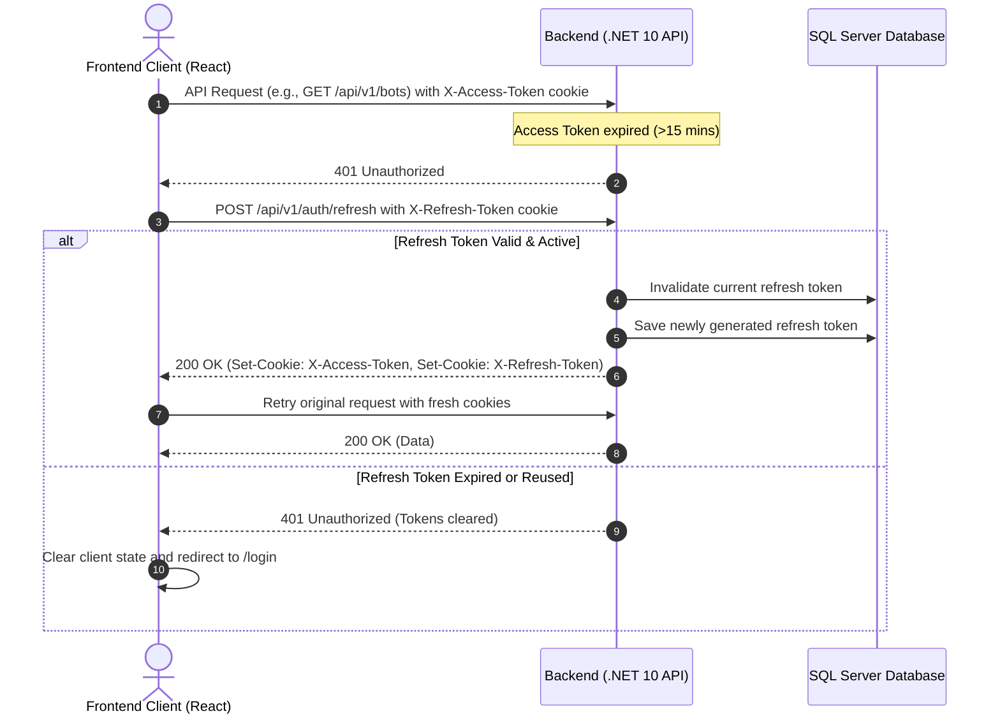

# FRONTEND_BACKEND_CONTRACT.md
## Production Integration Contract: Multi-Bot Automation & AI Agent SaaS Platform

> **Backend Architecture:** .NET 10 Web API, Clean Architecture, CQRS with MediatR, EF Core + SQL Server, ASP.NET Core Identity & JWT Authentication, Refresh Token Rotation with HTTP-Only Cookies, SignalR Hub, Node.js Playwright Workers.  
> **Frontend Target Stack:** React, TypeScript, Vite, Tailwind CSS, Axios, `@microsoft/signalr`.  
> **Contract Status:** Live & Fully Verified against current codebase.

---

## 1. API General Configuration

### 1.1 Base URL & Environment Configuration
- **Development Base URL:** `http://localhost:5000` (or `https://localhost:5001`)
- **Vite Local Dev Server Origin:** `http://localhost:5173`
- **Global Route Prefix:** `/api/v1/` for standard controllers (Note: `LeadsController` is routed at `/api/leads`).
- **SignalR Hub Route:** `/hubs/notifications`

### 1.2 Content-Type & Payload Conventions
- All JSON requests must send: `Content-Type: application/json`.
- All endpoints accept and return UTF-8 encoded JSON with `camelCase` property naming conventions (`JsonNamingPolicy.CamelCase`).
- EF Core circular references are ignored using `ReferenceHandler.IgnoreCycles`.

### 1.3 Credentials & Cookie Requirements
- **Globally Mandatory:** All Axios requests and SignalR connections from the frontend **must** set `withCredentials: true`.
- Authentication uses **HTTP-Only cookies** (`X-Access-Token` and `X-Refresh-Token`).
- Raw JWT tokens are **never** accessible to frontend JavaScript via `document.cookie` or response bodies.
- The frontend must **not** set manual `Authorization: Bearer <token>` headers; the browser automatically attaches HTTP-only cookies on every request when `withCredentials: true` is configured.

### 1.4 CORS Configuration
The backend defines the `FrontendPolicy` in `Program.cs`:
- **Allowed Origins:**
  - `http://localhost:5173` (Vite dev server)
  - `http://localhost:3000` (Alternative local frontend)
  - Configured n8n cloud webhook origins
- **Allowed Headers:** Any (`AllowAnyHeader()`)
- **Allowed Methods:** Any (`AllowAnyMethod()`)
- **Credentials:** Allowed (`AllowCredentials()`)

### 1.5 Cookie Security Flags (Dev & Production)
Cookies are generated via `TokenService`:
- `HttpOnly`: `true` (always)
- `Secure`: `true` (enables cross-site cookie transmission)
- `SameSite`: `SameSiteMode.None` (enables cross-origin requests between Vite on `localhost:5173` and API on `localhost:5000`)
- `Path`: `/`

### 1.6 Standard & Custom Headers
| Header | Usage | Required By |
| :--- | :--- | :--- |
| `Accept: application/json` | Standard client request format | All requests |
| `Content-Type: application/json` | Standard POST/PUT request bodies | All POST/PUT requests |
| `x-worker-api-key` | Bot worker authentication header | Worker endpoints (`/api/v1/worker/*`) |
| `X-Webhook-Secret` | n8n incoming webhook verification | Run completion endpoint (`/api/v1/runs/{id}/complete`) |
| `X-Idempotency-Key` | Idempotency key | **Not Found / Needs Clarification** (Not currently enforced by API) |

---

## 2. Authentication & Session Contract

### 2.1 Authentication Endpoints

#### 2.1.1 User Login
- **Method:** `POST`
- **Route:** `/api/v1/auth/login`
- **Auth Required:** No (Anonymous)
- **Request Body (`LoginRequestDto`):**
  ```json
  {
    "email": "user@example.com",
    "password": "Password123!"
  }
  ```
- **Response Body (`ApiResponse<AuthLoginResponseDto>`):**
  ```json
  {
    "isSuccess": true,
    "message": "Login successful.",
    "errorType": 0,
    "data": {
      "userId": "3fa85f64-5717-4562-b3fc-2c963f66afa6",
      "email": "user@example.com",
      "name": "Mazen Khtab",
      "role": "User"
    }
  }
  ```
- **Cookies Created in Response:**
  - `X-Access-Token`: Expiration 15 minutes, `HttpOnly: true`, `Secure: true`, `SameSite: None`, `Path: /`.
  - `X-Refresh-Token`: Expiration 7 days, `HttpOnly: true`, `Secure: true`, `SameSite: None`, `Path: /`.
- **Status Codes:**
  - `200 OK`: Successful authentication.
  - `400 Bad Request`: Validation failure (empty email or password).
  - `401 Unauthorized`: Invalid credentials or deleted/inactive account.

#### 2.1.2 Get Current User Identity / Session
- **Method:** `GET`
- **Route:** `/api/v1/auth/me`
- **Auth Required:** Yes (`[Authorize]`)
- **Request Body:** None
- **Response Body (`ApiResponse<AuthLoginResponseDto>`):**
  ```json
  {
    "isSuccess": true,
    "message": "User retrieved successfully.",
    "errorType": 0,
    "data": {
      "userId": "3fa85f64-5717-4562-b3fc-2c963f66afa6",
      "email": "user@example.com",
      "name": "Mazen Khtab",
      "role": "User"
    }
  }
  ```
- **Behavior:**
  - Reads authenticated user identity from claims (`ClaimTypes.NameIdentifier` and `ClaimTypes.Role`).
  - Verifies account existence in `Users` (or `SystmeAdmins`) table and checks `IsDeleted == false`.
  - Does **not** rotate tokens or set new cookies.
- **Status Codes:**
  - `200 OK`: Valid session.
  - `401 Unauthorized`: Unauthenticated or account deactivated/deleted.

#### 2.1.3 Refresh Token
- **Method:** `POST`
- **Route:** `/api/v1/auth/refresh`
- **Auth Required:** No explicit `[Authorize]` header required; reads cookie.
- **Request Body:** None (reads `X-Refresh-Token` cookie from HTTP request).
- **Response Body (`ApiResponse<AuthLoginResponseDto>`):**
  ```json
  {
    "isSuccess": true,
    "message": "Token refreshed successfully.",
    "errorType": 0,
    "data": {
      "userId": "3fa85f64-5717-4562-b3fc-2c963f66afa6",
      "email": "user@example.com",
      "name": "Mazen Khtab",
      "role": "User"
    }
  }
  ```
- **Cookies Rotated:**
  - Both `X-Access-Token` and `X-Refresh-Token` are renewed with fresh expirations.
  - Previous refresh token is revoked in database (`UserRefreshTokens`).
- **Status Codes:**
  - `200 OK`: Successful rotation.
  - `401 Unauthorized`: Missing or revoked/expired refresh token.

#### 2.1.4 User Logout
- **Method:** `POST`
- **Route:** `/api/v1/auth/logout`
- **Auth Required:** Yes (`[Authorize]`)
- **Request Body:** None
- **Response Body (`ApiResponse<bool>`):**
  ```json
  {
    "isSuccess": true,
    "message": "Logout successful.",
    "errorType": 0,
    "data": true
  }
  ```
- **Behavior:**
  - Reads `X-Refresh-Token` from request cookies.
  - Revokes matching token record in `UserRefreshTokens`.
  - Clears `X-Access-Token` and `X-Refresh-Token` cookies (sets expires to epoch in past).
- **Status Codes:**
  - `200 OK`: Successfully logged out.
  - `401 Unauthorized`: Unauthenticated.

#### 2.1.5 Admin Authentication Endpoints
Separated from standard client tables (`SystemAdmin` and `SystemAdminRefreshTokens`):
- `POST /api/v1/admin/auth/login`: Accepts `LoginRequestDto`, sets admin cookies, returns admin identity.
- `GET /api/v1/admin/auth/me`: `[Authorize]`. Returns currently authenticated admin identity (`AuthLoginResponseDto`) without rotating tokens or modifying cookies. Status `200 OK` on success, `401 Unauthorized` if unauthenticated or admin is inactive.
- `POST /api/v1/admin/auth/refresh`: Rotates admin refresh token from cookie.
- `POST /api/v1/admin/auth/logout`: Revokes admin refresh token and clears cookies.

#### 2.1.6 Registration & Password Reset
- **Registration:** **Not Found / Needs Clarification** (No registration endpoint currently exists in `AuthController`; accounts are seeded/created administratively).
- **Password Reset / Change:** **Not Found / Needs Clarification** (No password reset endpoints in `AuthController`).

---

### 2.2 Refresh Token Rotation & Session Invalidation Flow



#### Race Condition Handling (Concurrent 401s):
When multiple frontend API requests fail simultaneously with `401 Unauthorized`:
1. The frontend Axios response interceptor must maintain an `isRefreshing` lock flag and an array queue of pending requests.
2. The first failed request initiates `POST /api/v1/auth/refresh`.
3. Subsequent `401` requests are enqueued as callbacks waiting on the single refresh promise.
4. When refresh succeeds, all queued requests are replayed.
5. If refresh fails, the queue is rejected and the user is redirected to `/login`.

#### Single Active Session Policy:
- The backend enforces `SingleActiveSessionMiddleware` on regular user requests.
- Each login updates `User.CurrentSessionToken` in SQL Server and embeds that GUID into the `SessionToken` claim of the access token.
- If a user logs in from a second browser/device, calls from the first browser will return `401 Unauthorized` with:
  ```json
  { "message": "Your session has expired or ended because you logged in from another device." }
  ```

---

## 3. Authorization & Roles

### 3.1 Roles
- `User`: Standard platform customer. Scoped strictly to their own accounts, target groups, leads, and runs.
- `Admin`: System administrator.
- `SuperAdmin`: System super administrator with elevated privilege.

### 3.2 Authorization Rules
- All client dashboard endpoints require `[Authorize]` with role `User` (or admin).
- Admin endpoints reside under `/api/v1/admin/` and require administrative roles.
- Worker endpoints (`/api/v1/worker/*`) are protected by `[BotWorkerAuthorize]` requiring the `x-worker-api-key` header.
- Run completion webhook (`/api/v1/runs/{id}/complete`) is protected by `[N8nWebhookAuthorize]` requiring the `X-Webhook-Secret` header.

### 3.3 Account Status Checks
- When a user is marked `IsDeleted == true`, `GET /api/v1/auth/me` and login/refresh operations immediately reject with `401 Unauthorized`.

---

## 4. Standard API Response & Error Contract

### 4.1 Success Envelope Format
All successful operations return the `ApiResponse<T>` envelope:
```json
{
  "isSuccess": true,
  "message": "Operation completed successfully.",
  "errorType": 0,
  "data": { ... }
}
```

### 4.2 Error Envelope Format
When an operation fails, controllers return the `ApiErrorResponse` model:
```json
{
  "isSuccess": false,
  "statusCode": 400,
  "message": "One or more validation errors occurred.",
  "path": "/api/v1/runs",
  "method": "POST",
  "traceId": "0HN18S0GF2819:00000001",
  "details": null,
  "innerException": null
}
```
> *Note:* `details` and `innerException` contain stack trace info **only** when `ASPNETCORE_ENVIRONMENT == "Development"`.

### 4.3 ErrorType Enum Mapping
| Enum Name | Integer | HTTP Status | Meaning |
| :--- | :--- | :--- | :--- |
| `None` | `0` | 200 OK | Operation succeeded |
| `ValidationError` | `1` | 400 Bad Request | Invalid inputs or failed business validation |
| `NotFound` | `2` | 404 Not Found | Resource not found or not owned by user |
| `Unauthorized` | `3` | 401 Unauthorized | Missing, expired, or invalid session |
| `Forbidden` | `4` | 403 Forbidden | Access denied |
| `Conflict` | `5` | 409 Conflict | Concurrency or duplicate state conflict |
| `ServerError` | `6` | 500 Internal Error | Unhandled server or external network error |
| `TooManyRequests` | `7` | 429 Too Many Requests | Rate limit or duplicate job already in progress |

---

## 5. Pagination, Filtering, Sorting & Search

### 5.1 Request Conventions
- `pageNumber`: Integer (default `1`, 1-based indexing).
- `pageSize`: Integer (default `10`).
- `botId`: Integer filter (optional).
- `statusFilter`: String filter (optional).

### 5.2 Response Envelope Shape (`PaginatedResult<T>`)
List endpoints wrapping multiple items return `ApiResponse<PaginatedResult<T>>`:
```json
{
  "isSuccess": true,
  "message": "",
  "errorType": 0,
  "data": {
    "items": [ ... ],
    "totalItems": 42,
    "totalPages": 5,
    "currentPage": 1
  }
}
```

---

## 6. Client Dashboard APIs & Bot Registry

### 6.1 Bot Endpoints

#### 6.1.1 Get All Platform Bots
- **Method:** `GET`
- **Route:** `/api/v1/bots`
- **Auth:** `[Authorize]`
- **Query Params:** None
- **Response:** `ApiResponse<List<BotDto>>`
- **Behavior:** Returns all active bots available in the catalog, including whether the current user is subscribed (`isSubscribed: true/false`).

#### 6.1.2 Get User's Subscribed Bots
- **Method:** `GET`
- **Route:** `/api/v1/bots/subscribed`
- **Auth:** `[Authorize]`
- **Query Params:** None
- **Response:** `ApiResponse<List<BotDto>>`
- **Behavior:** Returns only the bots the authenticated user owns via the `UserBot` table.

#### 6.1.3 Get Bot by ID
- **Method:** `GET`
- **Route:** `/api/v1/bots/{id}`
- **Auth:** `[Authorize]`
- **Query Params:** `requireOwnership` (boolean, optional, default `false`).
- **Response:** `ApiResponse<BotDto>`

### 6.2 Complete `BotDto` Contract
```typescript
interface BotDto {
  id: number;
  name: string;
  description: string | null;
  currentPrice: number;
  uiModuleCode: string;
  cooldownMinutes: number;
  isActive: boolean;
  status: string;
  isSubscribed: boolean;
  subscribedAt: string | null; // ISO-8601 DateTime UTC
}
```

### 6.3 Stabilized `UiModuleCode` Values
The frontend Bot Registry dynamically mounts UI workspaces based on `uiModuleCode`. The supported codes defined in `SaaS.Domain.Constants.UiModuleCodes` are:

| Constant Key | Exact Value | Bot Purpose |
| :--- | :--- | :--- |
| `FbMembersScraper` | `FB-MEMBERS-SCRAPER` | Scrapes public/group Facebook member profiles |
| `FbPostsScraper` | `FB-POSTS-SCRAPER` | Scrapes posts and interactions from targeted Facebook groups |
| `FbMembersMessagesScraper` | `FB-MEMBERS-MESSAGES-SCRAPER` | Dispatches automated direct messages to collected leads |

---

## 7. Bot Workspace APIs

### 7.1 Connected Accounts Domain

#### 7.1.1 Get Eligible Connected Accounts for Run
- **Method:** `GET`
- **Routes:**
  - `/api/v1/connectedaccounts/eligible?botId={botId}`
  - `/api/v1/connectedaccounts/eligible/{botId}`
- **Auth:** `[Authorize]`
- **Rules Enforced:**
  - Account belongs to authenticated user (`UserId == currentUserId`).
  - Account is assigned to the requested bot (`BotId == botId`).
  - User owns subscription to bot (`UserBot` validated; returns 404 if not subscribed).
  - `IsActive == true`.
  - `Status == "Active"` (Accounts that are `"Busy"`, `"CoolingDown"`, `"AccountFlagged"`, or `"Banned"` are excluded).
  - Attached cookie exists and is not expired (`CookiesExpireDate > DateTime.UtcNow`).
- **Response Body (`ApiResponse<List<ConnectedAccountDto>>`):**
  ```json
  {
    "isSuccess": true,
    "message": "",
    "errorType": 0,
    "data": [
      {
        "id": 12,
        "displayName": "Facebook Sales Account #1",
        "platform": "Facebook",
        "expiredAt": "2026-10-25T14:30:00Z",
        "isActive": true
      }
    ]
  }
  ```
  *(If no account qualifies, returns `data: []` with status 200 OK, enabling the frontend to disable "Start Run").*

#### 7.1.2 List Connected Accounts
- **Method:** `GET`
- **Route:** `/api/v1/connectedaccounts`
- **Auth:** `[Authorize]`
- **Response:** `ApiResponse<List<ConnectedAccountDto>>`

#### 7.1.3 Get Connected Account Details
- **Method:** `GET`
- **Route:** `/api/v1/connectedaccounts/{id}`
- **Auth:** `[Authorize]`
- **Response Body (`ApiResponse<ConnectedAccountDetailsDto>`):**
  ```json
  {
    "isSuccess": true,
    "message": "",
    "errorType": 0,
    "data": {
      "id": 12,
      "displayName": "Facebook Sales Account #1",
      "platform": "Facebook",
      "maskedCookies": "sb=***; c_user=***",
      "expiredAt": "2026-10-25T14:30:00Z",
      "isActive": true,
      "relatedLeadsCount": 150,
      "runsCount": 14
    }
  }
  ```
  *(Note: Normalized property name is `expiredAt`, replacing previous `expAt`).*

#### 7.1.4 Create Connected Account
- **Method:** `POST`
- **Route:** `/api/v1/connectedaccounts`
- **Request Body (`AddConnectedAccountDto`):**
  ```json
  {
    "botId": 1,
    "displayName": "Facebook Account #2",
    "platform": "Facebook",
    "cookiesPayload": "[{\"name\":\"c_user\",\"value\":\"1000...\",\"domain\":\".facebook.com\"}]"
  }
  ```

#### 7.1.5 Update Connected Account
- **Method:** `PUT`
- **Route:** `/api/v1/connectedaccounts/{id}`
- **Request Body (`UpdateConnectedAccountDto`):**
  ```json
  {
    "displayName": "Facebook Account Renamed",
    "platform": "Facebook",
    "cookiesPayload": "[{\"name\":\"c_user\",\"value\":\"1000...\"}]",
    "status": "Active",
    "isActive": true,
  }
  ```

#### 7.1.6 Delete Connected Account
- **Method:** `DELETE`
- **Route:** `/api/v1/connectedaccounts/{id}`
- **Response:** `ApiResponse<bool>`

---

### 7.2 Target Groups Domain

#### 7.2.1 List Target Groups
- **Method:** `GET`
- **Route:** `/api/v1/targetgroups`
- **Auth:** `[Authorize]`
- **Response Body (`ApiResponse<List<GroupDto>>`):**
  ```json
  {
    "isSuccess": true,
    "message": "",
    "errorType": 0,
    "data": [
      {
        "id": 5,
        "groupName": "SaaS Entrepreneurs Group",
        "groupUrl": "https://www.facebook.com/groups/saasentrepreneurs",
        "isActive": true
      }
    ]
  }
  ```

#### 7.2.2 Get Target Group Details
- **Method:** `GET`
- **Route:** `/api/v1/targetgroups/{id}`
- **Auth:** `[Authorize]`
- **Response Body (`ApiResponse<GroupDetailsDto>`):**
  ```json
  {
    "isSuccess": true,
    "message": "",
    "errorType": 0,
    "data": {
      "id": 5,
      "groupName": "SaaS Entrepreneurs Group",
      "groupUrl": "https://www.facebook.com/groups/saasentrepreneurs",
      "configJson": "{\"keywords\": [\"founder\", \"ceo\"]}",
      "isActive": true,
      "relatedLeadsCount": 45,
      "runsCount": 3
    }
  }
  ```
  *(Note: Normalized property name is `groupUrl`, replacing previous `groupURL`).*

#### 7.2.3 Create Target Group
- **Method:** `POST`
- **Route:** `/api/v1/targetgroups`
- **Request Body (`AddGroupDto`):**
  ```json
  {
    "botId": 1,
    "groupName": "Tech Startups Hub",
    "groupUrl": "https://www.facebook.com/groups/techstartups",
    "configJson": "{\"minMembers\": 1000}",
    "isActive": true
  }
  ```

#### 7.2.4 Update Target Group
- **Method:** `PUT`
- **Route:** `/api/v1/targetgroups/{id}`
- **Request Body (`UpdateGroupDto`):**
  ```json
  {
    "groupName": "Updated Group Name",
    "groupUrl": "https://www.facebook.com/groups/techstartups",
    "configJson": "{\"minMembers\": 2000}",
    "isActive": true
  }
  ```

#### 7.2.5 Delete Target Group
- **Method:** `DELETE`
- **Route:** `/api/v1/targetgroups/{id}`
- **Response:** `ApiResponse<bool>`

---

### 7.3 Leads Domain

#### 7.3.1 Get Leads for Bot
- **Method:** `GET`
- **Route:** `/api/leads/leads/{botId}`
- **Auth:** `[Authorize]`
- **Query Params:**
  - `pageNumber` (default `1`)
  - `pageSize` (default `10`)
  - `statusFilter` (optional, e.g., `"Pending"`, `"Contacted"`, `"Qualified"`)
- **Response:** `ApiResponse<PaginatedResult<LeadDto>>`

#### 7.3.2 Get Messaging Preview Leads
- **Method:** `GET`
- **Route:** `/api/leads/bot/messaging-preview/{botId}`
- **Auth:** `[Authorize]`
- **Response:** `ApiResponse<List<LeadDto>>`

---

### 7.4 Worker Dispatch & Updates

#### 7.4.1 Dispatch Messaging Job (User Initiated)
- **Method:** `POST`
- **Route:** `/api/v1/worker/dispatch-messaging`
- **Auth:** `[Authorize]`
- **Request Body (`DispatchMessagingDto`):**
  ```json
  {
    "botId": 3,
    "accountId": 12,
    "leadIds": [101, 102, 103]
  }
  ```
- **Response Body (`ApiResponse<DispatchMessagingResultDto>`):**
  ```json
  {
    "isSuccess": true,
    "message": "Job accepted successfully.",
    "errorType": 0,
    "data": {
      "jobId": 85,
      "status": "Pending",
      "totalLeadsCount": 3
    }
  }
  ```

#### 7.4.2 Worker Node Callbacks (Protected by `x-worker-api-key`)
- `PUT /api/v1/worker/leads/{leadId}/status` - Update lead status (`UpdateStatusDto: { status: string }`).
- `PUT /api/v1/worker/jobs/{jobId}/status` - Update job status (`UpdateStatusDto: { status: string }`).
- `PUT /api/v1/worker/accounts/{accountId}/status` - Update account status (`UpdateStatusDto: { status: string }`).
- `POST /api/v1/worker/activity-log` - Post bot audit log (`LogBotActivityCommand`).

---

## 8. Runs / Jobs Contract

### 8.1 Runs Endpoints

#### 8.1.1 Start / Create Run
- **Method:** `POST`
- **Route:** `/api/v1/runs`
- **Auth:** `[Authorize]`
- **Request Body (`CreateRunDto`):**
  ```json
  {
    "botId": 1,
    "connectedAccountId": 12,
    "targetGroupId": 5,
    "infoJson": "{\"keywords\": [\"software\", \"founder\"], \"scrapeLimit\": 100}"
  }
  ```
- **Response Body (`ApiResponse<int>`):**
  ```json
  {
    "isSuccess": true,
    "message": "Run started successfully.",
    "errorType": 0,
    "data": 42
  }
  ```
- **Behavior:**
  - Validates user subscription to `BotId`.
  - Verifies account eligibility (`Status == "Active" && IsActive == true`).
  - Sets connected account `Status = "Busy"`.
  - Creates a `Run` record with `Status = "Running"`.
  - Triggers the configured n8n webhook for the bot's `UiModuleCode`.

#### 8.1.2 List Runs
- **Method:** `GET`
- **Route:** `/api/v1/runs`
- **Auth:** `[Authorize]`
- **Query Params:**
  - `botId`: Integer (optional)
  - `pageNumber`: Integer (default `1`)
  - `pageSize`: Integer (default `10`)
  - `statusFilter`: String (optional, e.g. `"Running"`, `"Completed"`, `"Cancelled"`, `"Failed"`)
- **Response Body (`ApiResponse<PaginatedResult<RunDto>>`):**
  ```json
  {
    "isSuccess": true,
    "message": "",
    "errorType": 0,
    "data": {
      "items": [
        {
          "id": 42,
          "botId": 1,
          "groupId": 5,
          "accountId": 12,
          "collectedLeadsCount": 35,
          "infoJson": "{\"keywords\":[\"software\"]}",
          "startedAt": "2026-10-12T14:00:00Z",
          "endedAt": null,
          "status": "Running"
        }
      ],
      "totalItems": 1,
      "totalPages": 1,
      "currentPage": 1
    }
  }
  ```

#### 8.1.3 Get Run by ID
- **Method:** `GET`
- **Route:** `/api/v1/runs/{id}`
- **Auth:** `[Authorize]`
- **Response Body (`ApiResponse<RunDto>`):**
  ```json
  {
    "isSuccess": true,
    "message": "",
    "errorType": 0,
    "data": {
      "id": 42,
      "botId": 1,
      "groupId": 5,
      "accountId": 12,
      "collectedLeadsCount": 35,
      "infoJson": "{\"keywords\":[\"software\"]}",
      "startedAt": "2026-10-12T14:00:00Z",
      "endedAt": null,
      "status": "Running"
    }
  }
  ```

#### 8.1.4 Cancel Run
- **Method:** `POST`
- **Route:** `/api/v1/runs/{id}/cancel`
- **Auth:** `[Authorize]`
- **Response Body (`ApiResponse<bool>`):**
  ```json
  {
    "isSuccess": true,
    "message": "Run cancelled successfully.",
    "errorType": 0,
    "data": true
  }
  ```
- **State Transitions & Business Rules:**
  - Validates that the run belongs to the authenticated user.
  - Can only cancel runs whose status is currently `"Running"`. If already `"Completed"`, `"Failed"`, or `"Cancelled"`, returns `400 Bad Request` (`ValidationError`).
  - Updates `Run.Status = "Cancelled"` and records `Run.EndedAt = DateTime.UtcNow`.
  - If the attached `ConnectedAccount` is `"Busy"`, reverts its status to `"Active"` so it is immediately unlocked for future runs.

#### 8.1.5 Complete Run (n8n Webhook Callback)
- **Method:** `POST`
- **Route:** `/api/v1/runs/{id}/complete`
- **Auth:** Header `X-Webhook-Secret`
- **Request Body (`CompleteRunDto`):**
  ```json
  {
    "extractedLeads": [
      {
        "externalId": "fb_102030",
        "username": "john.doe",
        "fullName": "John Doe",
        "aiMessage": "Hello John...",
        "metadataJson": "{\"profileLink\": \"...\"}"
      }
    ]
  }
  ```
- **Behavior:** Saves leads, increments `CollectedLeadsCount`, marks run as `"Completed"`, reverts account to `"Active"`, and sends SignalR `RunCompleted` event to client.

#### 8.1.6 Retry Run
- **Decision Status:** **Not Found / Needs Clarification (Unresolved)**
- **Technical Rationale:** The existing backend domain contains no defined retry mechanism, retry state transition, or webhook retry strategy for failed/completed runs. In accordance with architectural rules, business logic has not been invented. A retry currently requires the client to call `POST /api/v1/runs` to start a new run with the appropriate target group and configuration.

### 8.2 Enums and Domain Status Values

#### Run Status (`RunStatus`)
- `"Pending"`
- `"Running"`
- `"Completed"`
- `"Failed"`
- `"Cancelled"`

#### Job Status (`JobStatus`)
- `"Pending"`
- `"Processing"`
- `"Completed"`
- `"Failed"`

#### Account Status (`AccountStatus`)
- `"Active"`: Eligible to be picked for runs.
- `"Busy"`: Currently executing a run or worker task.
- `"CoolingDown"`: In post-run cooldown period.
- `"AccountFlagged"`: Flagged by external platform.
- `"Banned"`: Account banned.

---

## 9. Real-Time SignalR Notification Contract

### 9.1 Hub Connection Setup
- **Hub URL:** `/hubs/notifications`
- **Transport:** WebSockets (fallback to Long Polling).
- **Client Configuration:**
  ```typescript
  import * as signalR from "@microsoft/signalr";

  const connection = new signalR.HubConnectionBuilder()
    .withUrl("http://localhost:5000/hubs/notifications", {
      withCredentials: true // Transmits authentication cookies
    })
    .withAutomaticReconnect()
    .build();
  ```

### 9.2 Real-Time Events Emitted by Server

#### `RunCompleted`
- **Trigger:** Fired when a scraping run finishes via n8n callback.
- **Payload:**
  ```typescript
  interface RunCompletedPayload {
    runId: number;
    leadsCount: number;
  }
  ```

#### `LeadStatusUpdated`
- **Trigger:** Fired when a lead status is modified by worker processing.
- **Payload:**
  ```typescript
  interface LeadStatusUpdatedPayload {
    leadId: number;
    status: string; // e.g. "Contacted", "Failed"
  }
  ```

#### `JobFailed`
- **Trigger:** Fired when a background worker job encounters an unrecoverable failure.
- **Payload:**
  ```typescript
  interface JobFailedPayload {
    jobId: number;
    message: string;
  }
  ```
